# 🏡 House Price Least-Squares Model Comparison Platform
### Linear Algebra & Vector Calculus Software System
**Multi-Model Sequential Computational Pipeline, Subspace Projection Engine & Interactive Dashboard**

[](https://www.python.org/)
[](https://opensource.org/licenses/MIT)
[]()
[](https://share.streamlit.io/)
[](https://pages.github.com/)

---

## 📌 Section 1: Platform Overview

This software platform formulates, solves, verifies, and compares multiple least-squares models for predicting residential property prices using the geometric principles of **Linear Algebra and Vector Calculus**.

### Core Capabilities:
- **Pure-Python Linear Algebra Engine**: Implements `Vector` and `Matrix` arithmetic, transpose, Gauss-Jordan inversion, and Gram-Schmidt QR decomposition with **zero external dependencies**.
- **Orthogonal Projection Modeling**: Formulates least-squares regression geometrically as the projection of target vector $y$ onto the column space $\text{Col}(A)$.
- **Multidimensional Error Norm Evaluation**: Evaluates models across $L_1$ (Manhattan), $L_2$ (Euclidean/RMSE), and $L_\infty$ (Chebyshev/worst-case) error norms.
- **Interactive Multi-Tab Paging Interface**: Full-featured interactive dashboard with live property calculators, renovation simulator, matrix inspector, and dataset explorer.

---

## 🔄 Section 2: 8-Stage Sequential Computational Process

The system executes a strictly sequential computational workflow where each stage's output serves as the input to the next:

```mermaid
flowchart LR
    S1["1. House Data<br>(CSV Dataset)"] --> S2["2. Matrix Formation<br>(D ∈ R^{50×5}, y ∈ R^50)"]
    S2 --> S3["3. Feature Vectors<br>(x_j, Vector Stats)"]
    S3 --> S4["4. Design Matrices<br>(A_1, A_2, A_3 with 1)"]
    S4 --> S5["5. Least-Squares Solvers<br>(Normal Eqs & QR)"]
    S5 --> S6["6. Predictions<br>(ŷ = Aβ = Py)"]
    S6 --> S7["7. Residual Analysis<br>(e ⊥ Col(A), Aᵀe=0)"]
    S7 --> S8["8. Model Comparison<br>(L₁, L₂, L_∞ Norms, R²)"]
```



---

## 📊 Section 3: Model Comparison & Results

Evaluated on 50 real-world housing records (`data/houses.csv`):
- **Model 1 (Simple Linear Baseline)**: Bivariate model on Living Area ($n=2$).
- **Model 2 (Multivariable Linear)**: Area, Bedrooms, Bathrooms, Age, Transit Distance ($n=6$).
- **Model 3 (Polynomial & Interaction)**: Living area curvature ($x_{\text{area}}^2/1000$) and room interaction ($(x_{\text{area}} \cdot x_{\text{bed}})/1000$) ($n=6$).

### Comparative Performance Table:

| Model | Params ($n$) | $R^2$ Score | Adjusted $R^2$ | $L_1$ Norm (\$k) | $L_2$ Norm (\$k) | $L_\infty$ Norm (\$k) | RMSE (\$k) | Orthogonality $\|A^T e\|_2$ |
|---|:---:|:---:|:---:|:---:|:---:|:---:|:---:|:---:|
| **Model 3 (Polynomial & Interaction)** 🥇 | 6 | **0.9995** | **0.9994** | **151.07** | **25.84** | **7.37** | **\$3.65k** | $2.13 \times 10^{-5}$ |
| **Model 2 (Multivariable Linear)** 🥈 | 6 | 0.9984 | 0.9982 | 229.95 | 44.35 | 20.00 | \$6.27k | $1.08 \times 10^{-6}$ |
| **Model 1 (Simple Linear Baseline)** 🥉 | 2 | 0.9981 | 0.9981 | 273.99 | 48.19 | 18.05 | \$6.82k | $8.37 \times 10^{-8}$ |

**Key Findings:**
1. **Model 3 achieves a 42% reduction in RMSE** (\$3.65k vs \$6.27k) and reduces maximum single-property error bound ($L_\infty$) from \$20.00k down to \$7.37k.
2. Capturing non-linear interactions accurately models real estate market mechanics without overfitting (Adjusted $R^2 = 0.9994$).

---

## 💻 Section 4: Interactive Multi-Tab Platform Features

The platform is designed as a **full interactive paging application** (in both Streamlit Cloud `app.py` and GitHub Pages `docs/index.html`):

- **Tab 1: 📊 Executive Dashboard**: KPI cards, model leaderboard, and vector subspace diagrams.
- **Tab 2: ⚙️ 8-Stage Sequential Process**: Interactive accordion walking through the inputs, formulas, transformations, and outputs of each computational stage.
- **Tab 3: 📐 Matrix & Subspace Inspector**: Inspect design matrices $A_1, A_2, A_3$, Gram matrices $A^TA$, condition numbers $\kappa(A)$, and optimal parameter vectors $\beta$.
- **Tab 4: 🔮 Real-Time Estimator & Renovation Simulator**: Live sliders to estimate prices, plus quick simulation buttons:
  - *+1 Bedroom*
  - *+1 Bathroom*
  - *+350 sq ft Extension*
  - *Full Renovation (Age = 0)*
  - Real-time confidence intervals ($\pm 2\sigma$).
- **Tab 5: 📉 Residuals & Vector Error Norms**: Deep dive into $L_1$ (Manhattan), $L_2$ (Euclidean), and $L_\infty$ (Chebyshev) norms.
- **Tab 6: 🗄️ Dataset Explorer**: Real-time searchable and filterable table of the 50 properties with actual prices, Model 3 predictions, and residual errors.
- **Tab 7: 🔬 Mathematical Invariant Verification**: Verification logs confirming $A^T e = \mathbf{0}$, $P^2 = P$, $P^T = P$, and QR vs Normal Equations stability.

---

## 🔍 Section 5: Verified Mathematical Invariants

- **Residual Orthogonality ($A^T e = \mathbf{0}$)**: Verified perpendicular to column space with precision $< 10^{-5}$.
- **Projection Idempotency ($P^2 = P$)**: $\|P^2 - P\|_F = 3.07 \times 10^{-13}$ (machine zero).
- **Projection Symmetry ($P^T = P$)**: Confirmed self-adjoint linear operator.
- **QR vs Normal Equations Stability**: Gauss-Jordan inversion and Gram-Schmidt QR match to 12 decimal places.

---

## 🚀 Section 6: Quickstart & Execution

### 1. Run the Full Pipeline via CLI
Runs in standard Python 3 with zero external dependencies:
```bash
python3 main.py
```

### 2. Run the Unit Test Suite
```bash
python3 -m unittest discover tests
```
Runs 10 tests verifying vector operations, matrix inversion, QR factorization, and orthogonal projection invariants.

### 3. Launch Interactive Streamlit App Locally
```bash
pip install -r requirements.txt
streamlit run app.py
```

---

## 🌐 Section 7: Deployment Options

### Option A: Streamlit Community Cloud (Recommended ⭐)
1. Push this repository to GitHub.
2. Go to **[share.streamlit.io](https://share.streamlit.io)** and log in.
3. Select this repo, branch `main`, file `app.py`, and click **Deploy!**

### Option B: GitHub Pages (Free Static Hosting)
Enable GitHub Pages in your repo (`Settings` > `Pages` > branch `main` > folder `/docs`).  
It serves `docs/index.html` instantly with zero servers and zero upkeep!

---

## 📁 Section 8: Repository Structure

```
house_price_least_squares/
├── .github/workflows/ci.yml       # Automated GitHub Actions test pipeline
├── data/
│   └── houses.csv                 # 50-property housing dataset
├── docs/
│   ├── PROJECT_REPORT.md          # Comprehensive engineering & mathematical report
│   ├── DEPLOYMENT_GUIDE.md        # Step-by-step deployment guide
│   ├── index.html                 # Interactive multi-tab web application (GitHub Pages)
│   └── assets/                    # Vector SVG projection diagrams & charts
├── src/
│   ├── linear_algebra.py          # Custom pure-Python Vector, Matrix, QR engine
│   ├── pipeline.py                # 8-stage sequential computational pipeline
│   └── visualizer.py              # SVG chart and terminal table generator
├── tests/
│   └── test_linear_algebra.py     # Automated unit test suite (10/10 tests)
├── app.py                         # Interactive Streamlit multi-tab web application
├── main.py                        # Main CLI pipeline execution script
├── Dockerfile                     # Container specification
├── requirements.txt               # Streamlit cloud dependencies
└── README.md                      # Platform documentation
```

---
*House Price Least-Squares Model Comparison System — Linear Algebra & Vector Calculus Platform.*
