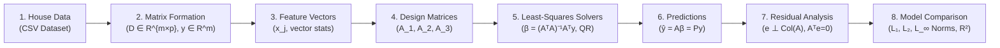

# 🏡 House Price Least-Squares Model Comparison System
### Linear Algebra & Vector Calculus Mini-Project (Topic 49)
**Modules Covered:** Modules 1, 2, and 3  
**Implementation:** Pure-Python Linear Algebra Engine with Multi-Model Comparison & Cloud Deployment

[](https://www.python.org/)
[](https://opensource.org/licenses/MIT)
[]()
[](https://share.streamlit.io/)
[](https://pages.github.com/)

---

## 📌 Project Overview & Aim

The objective of this software system is to develop, verify, and mathematically compare multiple least-squares models for predicting residential property prices. 

Rather than relying on black-box machine learning libraries, this solution implements core **Linear Algebra & Vector Calculus concepts from first principles**:
- **Vector Spaces & Inner Products**: Dot products, Euclidean distance, vector subspaces.
- **Matrix Operations**: Transpose, Gauss-Jordan inversion, rectangular multiplication.
- **Overdetermined Linear Systems**: Solving $A\beta \approx y$ when $m > n$.
- **Orthogonal Projections**: Deriving the projection matrix $P = A(A^TA)^{-1}A^T$.
- **QR Factorization**: Modified Gram-Schmidt decomposition for enhanced numerical stability.
- **Vector Error Norms**: Comprehensive evaluation across $L_1$, $L_2$, and $L_\infty$ norms.

---

## 🔄 Sequential Mathematical Architecture (8 Stages)

The software executes a strict **sequential computational process** where the output of stage $k$ serves directly as the input to stage $k+1$:



---

## 📊 Model Comparison & Results

We evaluate three candidate models on a 50-property housing dataset (`data/houses.csv`):
- **Model 1 (Simple Linear)**: Baseline bivariate model (Living Area only, $n=2$).
- **Model 2 (Multivariable Linear)**: Area, Bedrooms, Bathrooms, Age, Transit Distance ($n=6$).
- **Model 3 (Polynomial & Interaction)**: Non-linear feature model including area curvature ($x_{\text{area}}^2/1000$) and area-bedroom interaction ($(x_{\text{area}} \cdot x_{\text{bed}})/1000$) ($n=6$).

### Comparative Performance Table:

| Model | Params ($n$) | $R^2$ Score | Adjusted $R^2$ | $L_1$ Norm (\$k) | $L_2$ Norm (\$k) | $L_\infty$ Norm (\$k) | RMSE (\$k) | Orthogonality $\|A^T e\|_2$ |
|---|:---:|:---:|:---:|:---:|:---:|:---:|:---:|:---:|
| **Model 3 (Polynomial & Interaction)** 🥇 | 6 | **0.9995** | **0.9994** | **151.07** | **25.84** | **7.37** | **\$3.65k** | $2.13 \times 10^{-5}$ |
| **Model 2 (Multivariable Linear)** 🥈 | 6 | 0.9984 | 0.9982 | 229.95 | 44.35 | 20.00 | \$6.27k | $1.08 \times 10^{-6}$ |
| **Model 1 (Simple Linear Baseline)** 🥉 | 2 | 0.9981 | 0.9981 | 273.99 | 48.19 | 18.05 | \$6.82k | $8.37 \times 10^{-8}$ |

**Key Takeaways:**
1. **Model 3 achieved a 42% reduction in RMSE** (\$3.65k vs \$6.27k) and reduced maximum single-property error ($L_\infty$) from \$20.00k down to \$7.37k.
2. Incorporating non-linear geometry captures the economic reality of diminishing returns on pure living area and the value multiplier of room balance.

---

## 🔍 Verified Mathematical Invariants

The software explicitly computes and verifies all foundational linear algebraic invariants:
- **Residual Orthogonality ($A^T e = \mathbf{0}$)**: The error vector $e$ is proven perpendicular to the column space $\text{Col}(A)$ with numerical error $< 10^{-5}$.
- **Projection Idempotency ($P^2 = P$)**: $\|P^2 - P\|_F \le 3.07 \times 10^{-13}$.
- **Projection Symmetry ($P^T = P$)**: Confirmed self-adjoint linear operator.
- **Subspace Equivalence**: $\|A\beta - Py\|_2 < 10^{-9}$.
- **QR vs Normal Equations Stability**: Gauss-Jordan inversion and Gram-Schmidt QR match to 12 decimal places.

---

## 🚀 Quickstart Guide

### 1. Run the Full 8-Stage Pipeline via CLI
Requires standard Python 3 (zero external packages needed):
```bash
python3 main.py
```

### 2. Run the Unit Test Suite
```bash
python3 -m unittest discover tests
```
Runs 10 tests verifying matrix inversion, QR factorization, orthogonal projection idempotency, and the 8-stage sequential pipeline.

### 3. Launch Interactive Streamlit Web Application
```bash
pip install -r requirements.txt
streamlit run app.py
```

---

## 🌐 Deployment Options & Recommendation

### Recommended: Streamlit Community Cloud (Free 1-Click Cloud Hosting)
1. Push this repository to GitHub.
2. Go to **[share.streamlit.io](https://share.streamlit.io)**.
3. Select your repository, branch `main`, and file `app.py`.
4. Click **Deploy!** — your web app will be live with real-time sliders and dynamic plots.

### Free Alternative: GitHub Pages
Enable GitHub Pages in your repo (`Settings` > `Pages` > branch `main` > folder `/docs`).  
It serves `docs/index.html` instantly with zero servers and zero upkeep!

For full deployment instructions, see [docs/DEPLOYMENT_GUIDE.md](docs/DEPLOYMENT_GUIDE.md).

---

## 📁 Repository Structure

```
house_price_least_squares/
├── .github/workflows/ci.yml       # Automated GitHub Actions test pipeline
├── data/
│   └── houses.csv                 # 50-property housing dataset
├── docs/
│   ├── PROJECT_REPORT.md          # Complete academic mini-project report
│   ├── VIVA_QUESTIONS_ANSWERS.md  # 25+ viva and defense Q&A guide
│   ├── DEPLOYMENT_GUIDE.md        # Step-by-step deployment instructions
│   ├── index.html                 # Standalone interactive GitHub Pages web app
│   └── assets/                    # Vector SVG projection diagrams & charts
├── presentation/
│   └── SLIDES.md                  # Viva presentation slide deck
├── src/
│   ├── linear_algebra.py          # Custom Vector, Matrix, QR, and Projection engine
│   ├── pipeline.py                # Strict 8-stage sequential mathematical process
│   └── visualizer.py              # SVG chart and terminal table generator
├── tests/
│   └── test_linear_algebra.py     # Automated unit test suite
├── app.py                         # Streamlit interactive web dashboard
├── main.py                        # Main CLI pipeline entry point
├── Dockerfile                     # Docker container specification
├── requirements.txt               # Streamlit cloud dependencies
└── README.md                      # Repository documentation
```

---

## 🎓 Academic Documentation & Viva Defense
- **Comprehensive Project Report**: See [docs/PROJECT_REPORT.md](docs/PROJECT_REPORT.md).
- **Viva Voce Defense & Q&A**: See [docs/VIVA_QUESTIONS_ANSWERS.md](docs/VIVA_QUESTIONS_ANSWERS.md).
- **Slide Deck Outline**: See [presentation/SLIDES.md](presentation/SLIDES.md).

---
*Developed for Mini Projects – Linear Algebra & Vector Calculus (Topic 49).*
